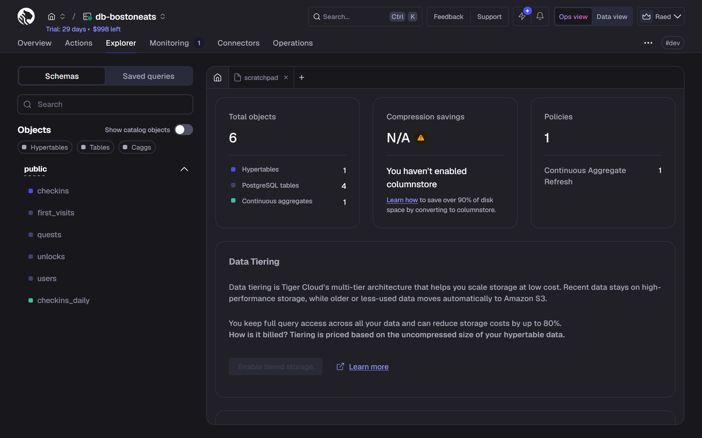
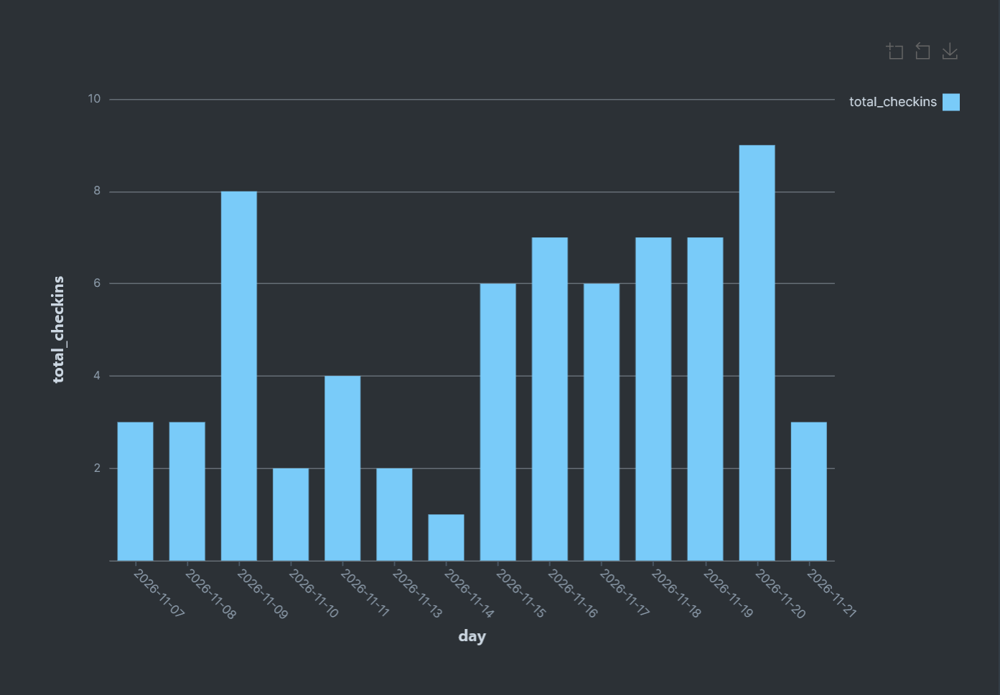

# Tiger Data in [NAME]

All game state lives in Tiger Data (Postgres + TimescaleDB): players, every check-in, first visits, neighborhood unlocks and line quests. The leaderboards are plain SQL over it. Schema: [`db/schema.sql`](../db/schema.sql).



## Why check-ins are a hypertable

A check-in is an event: who ate where, and when. Rows are only ever appended, and almost every question we ask is scoped by time ("this week", "per day"). That's exactly what hypertables are for.

- `checkins` is partitioned on `created_at` into **1-day chunks**. Recent queries touch only recent chunks, so the leaderboards stay fast as history grows.
- Postgres constraints still do the game logic. A hypertable's unique keys must include the time column, so "one check-in per restaurant per player" lives in a small regular table, `first_visits (uid, restaurant_id)`. Its primary key makes double-dipping impossible at the database level, even under concurrent requests.

## One check-in = one transaction

`POST /api/checkin` runs a single Postgres transaction ([`src/lib/store.ts`](../src/lib/store.ts)). It either all lands or none of it does:

1. Upsert the player, which also row-locks them so two simultaneous check-ins can't both miss an unlock.
2. `INSERT INTO first_visits ... ON CONFLICT DO NOTHING RETURNING 1`. No row back means "already checked in here".
3. Append the check-in to the hypertable.
4. Count distinct restaurants in that neighborhood. At 3, `INSERT INTO unlocks ... ON CONFLICT DO NOTHING RETURNING 1` tells us it's a *new* unlock.
5. Merge the stop into each line quest's `text[]` and complete it at 5 stops.
6. `UPDATE users SET points = points + $2, co2_saved_kg = co2_saved_kg + $3`.


## Continuous aggregate

```sql
CREATE MATERIALIZED VIEW checkins_daily
WITH (timescaledb.continuous, timescaledb.materialized_only = false) AS
SELECT time_bucket(INTERVAL '1 day', created_at) AS day, neighborhood, uid, count(*) AS checkins
  FROM checkins WHERE verified
 GROUP BY day, neighborhood, uid;
```

A refresh policy runs it every 15 minutes, and `materialized_only = false` makes it real-time: rows since the last refresh are still included. A check-in row is written only on a first visit, so summing the daily counts gives each player's distinct restaurants in a neighborhood, which is exactly the neighborhood leaderboard.

## The leaderboard queries

From [`src/lib/leaderboard.ts`](../src/lib/leaderboard.ts):

```sql
-- Citywide
SELECT uid AS id, display_name AS name, college, points
  FROM users ORDER BY points DESC, display_name LIMIT $1;

-- By college (index on (college, points DESC))
SELECT uid AS id, display_name AS name, college, points
  FROM users WHERE college = $1 ORDER BY points DESC, display_name LIMIT $2;

-- Per neighborhood, from the continuous aggregate
SELECT u.uid AS id, u.display_name AS name, u.college, SUM(d.checkins)::int AS points
  FROM checkins_daily d JOIN users u USING (uid)
 WHERE d.neighborhood = $1
 GROUP BY u.uid, u.display_name, u.college
 ORDER BY points DESC, name LIMIT $2;
```

Check-in activity over time, charted in the Tiger console straight from the continuous aggregate:

```sql
SELECT day::date AS day, SUM(checkins)::int AS total_checkins
  FROM checkins_daily
 GROUP BY 1 ORDER BY 1;
```



## Seed data with real history

`npm run data:seed` creates 42 players across BU, Northeastern, Tufts, MIT, Harvard and Emerson. Their check-ins are backdated over the past 14 days, so the hypertable has real chunks and the chart has a shape. Every seeded check-in goes through the same transaction as a live one, so seeded points, unlocks and quests follow the real rules.

## Demo resilience

Without `DATABASE_URL`, the app falls back to an in-memory store that runs the same rules on the same seed players. If the database becomes unreachable mid-demo, leaderboards fall back to memory instead of erroring.
